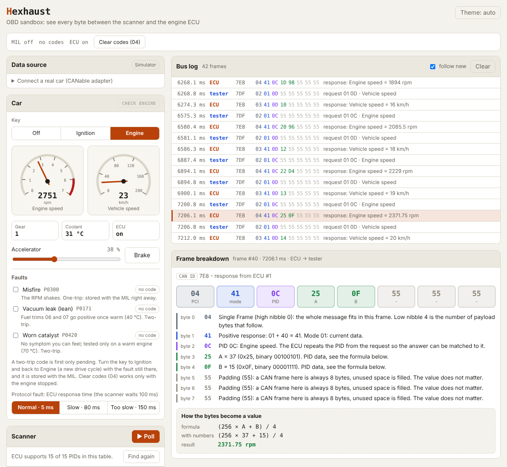

# Hexhaust

[](https://github.com/lev-oxr/hexhaust/actions/workflows/deploy.yml)

**Live: https://lev-oxr.github.io/hexhaust/**

A browser sandbox for OBD-II diagnostics. A simulated car and a scan tool talk over a virtual CAN bus, and you can click any frame to see what every byte means. Plug in a CANable adapter and the same scanner reads a real car.

<picture>
  <source media="(prefers-color-scheme: dark)" srcset="docs/screenshot-dark.png" />
  
</picture>

## What you can do

- Turn the key, press the accelerator and watch engine speed and vehicle speed change inside the ECU's response bytes.
- Poll PIDs from a table, or send your own request in hex: `01 0C`, `09 02`, `03`.
- Click any frame in the bus log. The breakdown labels every byte (PCI, mode, PID, data, padding) and shows the formula with your numbers filled in.
- Read the VIN and trouble codes. They don't fit in one CAN frame, so you see ISO-TP at work: First Frame → Flow Control → Consecutive Frames.
- Turn on faults: misfire, vacuum leak, worn catalyst. A two-trip code is pending first (mode 07), then stored (mode 03) with the MIL on, and mode 04 clears it.
- Make the ECU slow and watch late responses get flagged in the log.
- Switch from the simulator to a real car through a CANable adapter over Web Serial.

## A one-minute tour

1. Open the live link. The log already holds `7DF 02 01 00 …` and the ECU's replies: the scanner asked which PIDs the engine supports.
2. Turn the key to **Engine**, press **▶ Poll** and drag the **Accelerator**.
3. Click a row `7E8 04 41 0C …`. The breakdown explains each byte and computes `(256 × A + B) / 4`.
4. Press **Read VIN** and look at the log: one request, then a First Frame, our Flow Control and two Consecutive Frames carry 17 characters.

## Real car (CANable adapter)

Hexhaust talks to a car through a CANable 2.0 USB adapter running the
[Slcan 2.5 firmware](https://github.com/Elmue/CANable-2.5-firmware-Slcan-and-Candlelight).
The browser opens it as a serial port (Web Serial) and speaks slcan. The same ISO-TP code that runs the simulator handles the real frames, including our Flow Control.

| Browser | Simulator | CANable |
| --- | --- | --- |
| Chrome, Edge, Opera (desktop) | ✓ | ✓ USB |
| Chrome (Android) | ✓ | ✗ Web Serial on Android supports Bluetooth only |
| Firefox, Safari | ✓ | ✗ no Web Serial |

Wiring from the OBD-II port: pin 6 → CAN-H, pin 14 → CAN-L, pin 5 → GND. Leave pin 16 (+12 V) disconnected and the adapter's terminator off. The car needs to speak CAN (most cars from the late 2000s on; all US cars from 2008).

- **Listen only** watches the bus without sending anything, not even acknowledgements.
- Only read-only diagnostic services are sent by default. "Clear codes" (04) also resets the readiness monitors, so it stays blocked until you tick **Allow state-changing services**.
- Non-OBD frames are hidden and counted; untick **Log only OBD frames** to see them.
- **Download raw log (.txt)** saves the whole conversation with the adapter.

> Tested against a simulated CANable; not yet tried on a real car.

## Run locally

Requires Node.js 22 or newer (CI uses Node 24).

```bash
git clone https://github.com/lev-oxr/hexhaust.git
cd hexhaust
npm install
npm run dev
```

Open http://localhost:5173/hexhaust/ (the `/hexhaust/` path matters: the app is built for GitHub Pages).

| Script | What it does |
| --- | --- |
| `npm run dev` | dev server with hot reload |
| `npm test` | unit tests (Vitest) |
| `npm run build` | type check and production build into `dist/` |
| `npm run preview` | serve the production build locally |

Every push to `main` runs the type check, the tests and the build, then deploys `dist/` to GitHub Pages. Pull requests get the same checks without the deploy.

## How it is built

Vite + TypeScript + plain DOM, no framework.

```
src/
├── core/         pure logic, no DOM: bytes in, bytes out
│   ├── can/      CAN frame type and an event-driven virtual bus
│   ├── isotp/    splitting and reassembling long messages, flow control
│   ├── obd/      PID table, trouble codes, VIN, byte-by-byte explanations
│   ├── vehicle/  car physics, faults, the engine ECU
│   └── scanner/  request queue, polling, 100 ms timeout
├── transport/    simulator or a real CAN bus via slcan over Web Serial
└── ui/           data source, car panel, scanner, bus log, frame breakdown
```

- **The core knows nothing about the page**, so all of it is covered by tests.
- **A real bus is just another `CanBus`.** The slcan adapter sits behind the same interface as the virtual bus, so the scanner, ISO-TP and the log don't know which one they talk to.
- **Time comes from a `Clock` object**, so tests replace it with a fake clock and a 100 ms timeout runs instantly.

## Learn the protocol

- [OBD2 and ISO-TP basics](docs/OBD2%20and%20ISO-TP%20basics.md): a short primer written for this project
- [OBD2 Explained](https://csselectronics.com/pages/obd2-explained-simple-intro), CSS Electronics
- [OBD-II PIDs](https://en.wikipedia.org/wiki/OBD-II_PIDs), Wikipedia
- [UDS Explained](https://www.csselectronics.com/pages/uds-protocol-tutorial-unified-diagnostic-services) (ISO-TP section), CSS Electronics
- [Web Serial API](https://developer.mozilla.org/en-US/docs/Web/API/Web_Serial_API), MDN

## License

[MIT](LICENSE)
